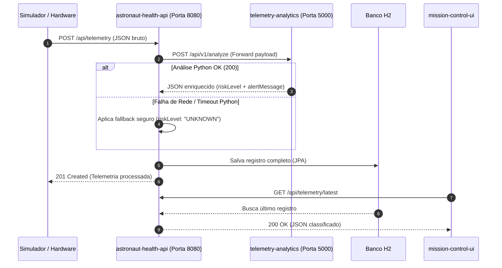

# 🚀 Astronaut Health API — Core API & Persistência

> **Organização:** [Rapadura Cósmica](https://github.com/Rapadura-Cosmica) — NASA Space Apps Challenge 2026 (Campina Grande, PB)  
> **Stack:** Java 17+, Spring Boot 3, Spring Web, Spring Data JPA, H2 Database  
> **Responsáveis:** Mateus Queiroz & Grimaldo Júnior

---

## 📋 Visão Geral

O **`astronaut-health-api`** é o núcleo orquestrador e de persistência da arquitetura do sistema de monitoramento de saúde de astronautas. Ele atua como o *gateway* central entre a camada de borda (Hardware/Simulador), o motor de inteligência clínica (**`telemetry-analytics`** em Python/Flask) e o painel operacional da tripulação (**`mission-control-ui`**).

### Responsabilidades no Ecossistema (MVP)
1. **Ingestão de Telemetria:** Receber os dados biométricos brutos enviados pelo hardware ou simulador (`POST /api/telemetry`).
2. **Orquestração Clínica:** Encaminhar o payload recebido via HTTP para o microsserviço de análise em Python (`POST /api/v1/analyze`) para validação e triagem de risco.
3. **Persistência & Histórico:** Salvar o registro biométrico já enriquecido (`riskLevel` e `alertMessage`) no banco de dados **H2**.
4. **Exposição para o Painel:** Disponibilizar a leitura mais recente e o histórico clínico para o Front-end via REST (`GET /api/telemetry/latest`), com CORS devidamente habilitado.

> **Nota de Escopo (MVP):** Para garantir máxima velocidade de entrega e estabilidade durante o hackathon, esta API utiliza **H2 Database** (sem dependência de bancos externos ou autenticação JWT nesta fase) e delega 100% do cálculo de severidade clínica ao serviço Python (`telemetry-analytics`).

---

## 🏗️ Fluxo de Comunicação



---

## 🗂️ Arquitetura de Pacotes (Spring Boot)

Estrutura enxuta focada em clareza, manutenibilidade e integração rápida:

```text
src/main/java/com/rapaduracosmica/astronauthealth/
│
├── config/
│   └── CorsConfig.java              # Liberação de acesso para o mission-control-ui
├── client/
│   └── AnalyticsClient.java         # Cliente HTTP (RestClient/RestTemplate) -> Python :5000
├── controller/
│   └── TelemetryController.java     # Endpoints /api/telemetry e /api/telemetry/latest
├── dto/
│   └── TelemetryDTO.java            # Contrato JSON único (camelCase) de entrada e saída
├── model/
│   └── TelemetryRecord.java         # Entidade JPA mapeada para o H2
├── repository/
│   └── TelemetryRepository.java     # Interface Spring Data JPA
└── service/
    └── TelemetryService.java        # Orquestração: recebe -> chama Python -> salva no H2
```

---

## 🔌 Contrato de Integração (API Endpoints)

### 1. Ingestão de Telemetria (`POST /api/telemetry`)
Recebe os dados do simulador/ESP32, envia ao Python para classificação e salva no H2.

* **Request Body (JSON):**
```json
{
  "astronautId": "ASTRO-01",
  "timestamp": "2026-11-14T15:30:00Z",
  "heartRate": 118,
  "spo2": 96,
  "radiationDoseMsv": 0.4,
  "sleepHours": 7.2
}
```

* **Response (`201 Created`):**
```json
{
  "id": 1,
  "astronautId": "ASTRO-01",
  "timestamp": "2026-11-14T15:30:00Z",
  "heartRate": 118,
  "spo2": 96,
  "radiationDoseMsv": 0.4,
  "sleepHours": 7.2,
  "riskLevel": "WARNING",
  "alertMessage": "Frequência cardíaca elevada/baixa detectada. Recomenda-se hidratação e repouso."
}
```

### 2. Consulta Última Leitura (`GET /api/telemetry/latest`)
Retorna o registro mais recente salvo no banco para atualização em tempo real do painel do astronauta.

* **Query Param Opcional:** `?astronautId=ASTRO-01`
* **Response (`200 OK`):** Mesmo formato JSON da resposta acima.

### 3. Histórico de Telemetria (`GET /api/telemetry`)
Retorna a lista de registros armazenados (útil para gráficos de evolução no dashboard).

---

## ⚙️ Configuração (`application.properties`)

```properties
server.port=8080

# H2 Database (Em memória + Console Web ativo)
spring.datasource.url=jdbc:h2:mem:astronautdb;DB_CLOSE_DELAY=-1
spring.datasource.driverClassName=org.h2.Driver
spring.datasource.username=sa
spring.datasource.password=
spring.jpa.database-platform=org.hibernate.dialect.H2Dialect
spring.jpa.hibernate.ddl-auto=update
spring.h2.console.enabled=true
spring.h2.console.path=/h2-console

# URL do Microsserviço Python (telemetry-analytics)
analytics.service.url=http://localhost:5000/api/v1/analyze
```

---

## 🚀 Como Executar Localmente

### Pré-requisitos
* **Java 17** ou superior
* **Maven 3.8+** (ou wrapper `./mvnw`)
* Serviço **`telemetry-analytics`** rodando na porta `5000` (opcional para subir, obrigatório para análise real)

### Passos
```bash
# 1. Clonar o repositório
git clone https://github.com/Rapadura-Cosmica/astronaut-health-api.git
cd astronaut-health-api

# 2. Compilar e rodar a aplicação
./mvnw spring-boot:run
```

* **API Base URL:** `http://localhost:8080`
* **Console do Banco H2:** `http://localhost:8080/h2-console` (JDBC URL: `jdbc:h2:mem:astronautdb`)

---

## 📅 Checklist de Entrega (MVP)

- [ ] Criar projeto Spring Boot (`Spring Web`, `Spring Data JPA`, `H2 Database`, `Validation`)
- [ ] Implementar `TelemetryDTO` respeitando exatamente os nomes em `camelCase` do contrato
- [ ] Implementar `AnalyticsClient` apontando para `http://localhost:5000/api/v1/analyze` com tratamento de fallback caso o Python esteja offline
- [ ] Criar `TelemetryRecord` e `TelemetryRepository`
- [ ] Expor `POST /api/telemetry` e `GET /api/telemetry/latest`
- [ ] Configurar CORS global (`*`) para evitar bloqueio no `mission-control-ui`
- [ ] Validar integração ponta a ponta com `telemetry-analytics` e `mission-control-ui`
